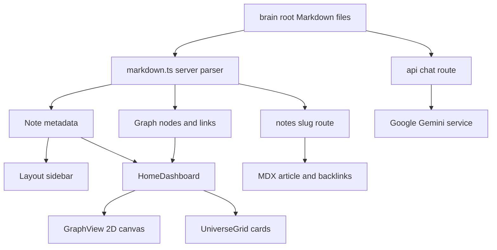

# Quant OS — Project Blueprint

A source grounded guide to the Quant OS reading interface and the quantitative ideas in its notes.

## 1. Purpose and evidence boundary

Quant OS is a **portfolio learning prototype**. Its application organizes authored Markdown notes about risk, finance, statistics, machine learning, and related projects. A reader can browse relationships, open long form notes, search titles, and optionally ask a Gemini based assistant questions. It demonstrates content driven web engineering and makes an analytical curriculum easier to explore.

The repository does **not** ship the notebooks, raw datasets, trained models, backtests, live market feeds, or financial execution systems described within some notes. Their numerical results are historical author reports. Source inspection confirms the reading software and the presence of the text, but cannot independently validate those experiments. The older [SOURCE_OF_TRUTH.md](SOURCE_OF_TRUTH.md) records historical design intent; use this blueprint and the current source for present behavior.

## 2. Reader experience

1. The home route loads note metadata and graph data from Markdown files on the server.
2. The default home tab is **Graph**. Click a node to open its note; use zoom and fit controls to inspect the canvas.
3. **Grid** lists root notes as cards. **Portfolio** filters cards to the portfolio project cluster. **Overview** opens the track introduction.
4. The shell sidebar groups notes by cluster and searches their titles. A mobile header opens the sidebar on smaller screens.
5. Each note page shows frontmatter metadata, a rendered article, and linked mentions from other notes.
6. The optional Vian AI panel sends chat messages to the server route after a client side clearance check. That is a presentation gate, not access control.

The implementation is a 2D canvas and document interface. Terms such as “spatial OS,” “neural map,” and “sync” are visual language, not separate operating system or learning analytics functionality.

## 3. Stack and architecture

| Layer | Source | Role |
| --- | --- | --- |
| Framework | [package.json](package.json), [app layout](src/app/layout.tsx) | Next.js 16 App Router, React 19, TypeScript |
| Content | [brain/](brain), [parser](src/lib/markdown.ts) | Committed Markdown with YAML frontmatter and wikilinks; server filesystem reads |
| Home | [page.tsx](src/app/page.tsx), [HomeDashboard.tsx](src/components/HomeDashboard.tsx) | Server loads data; client selects graph, grid, or portfolio view |
| Graph | [GraphView.tsx](src/components/GraphView.tsx) | Client only `react-force-graph-2d` canvas, cluster colors, node routing, zoom |
| Browse | [UniverseGrid.tsx](src/components/UniverseGrid.tsx), [Sidebar.tsx](src/components/Sidebar.tsx), [MobileHeader.tsx](src/components/MobileHeader.tsx) | Cards, title search, cluster grouping, responsive navigation |
| Articles | [note route](src/app/notes/%5Bslug%5D/page.tsx) | MDX rendering with GFM, line breaks, KaTeX, and highlighted code |
| Chat | [VianAIChat.tsx](src/components/VianAIChat.tsx), [chat route](src/app/api/chat/route.ts) | Client chat UI; server assembles note text and streams a Google model response |
| Style | [globals.css](src/app/globals.css) | Tailwind CSS 4 plus custom dark theme and Geist fonts |



Home and note routes are server components; interactive panels are client components. The graph library is dynamically imported with server rendering disabled because it needs browser canvas APIs. Selected home tab, search text, sidebar openness, chat messages, and chat clearance live in React state. No code persists them to a browser store or database. Refreshing resets these controls; `progress` is committed content metadata.

## 4. Content and navigation pipeline

The parser looks only at `.md` files **directly inside** `brain/`: 14 root notes in this snapshot. [The project summary in `brain/other_files/`](brain/other_files/14_portfolio_projects_master_summary.md) is preserved but not indexed by the application. Each root filename without `.md` is its route slug. Frontmatter supplies title, date, cluster, tags, progress, and optional `graph_exclude`.

| Operation | Actual rule | Consequence |
| --- | --- | --- |
| Note list | Read root `.md` files and parse YAML frontmatter | Grid and sidebar can show all 14 root notes |
| Detail | Read `brain/<slug>.md`; convert wikilinks outside simple `$...$` and `$$...$$` spans | `/notes/<slug>` renders the article or a 404 |
| Backlinks | Scan other root note bodies for matching `[[slug]]` or spaced slug | Incoming references appear below an article |
| Graph nodes | Include root notes unless `graph_exclude` is true | The modeling workflow reference remains accessible but absent from the graph; 13 graph nodes in this snapshot |
| Graph edges | Find wikilinks whose normalized target equals an included filename; omit self links and duplicate targets per file | Edges encode explicit authored links, not similarity or citations |
| Search | Case insensitive title substring match in the sidebar | It does not search article bodies |

Example: `[[1_lending_club_credit_risk_masterclass|Credit risk]]` becomes a link to `/notes/1_lending_club_credit_risk_masterclass`. A graph edge appears only if that filename exists among included nodes. The regex based conversion does not fully parse Markdown or MDX: code fences and currency dollar signs can produce unexpected matches. An article link can point at a missing slug because conversion does not verify its target; graph building does.

The article route removes the first line matching `# ...` to avoid repeating its frontmatter title and inserts a space after `<` before digits to avoid MDX parsing errors. These are pragmatic text substitutions, not a Markdown validation pipeline. Date and percent frontmatter are not validated at write time.

## 5. Quantitative concepts in the content

The formulas below explain the **notes’ subjects**. They are educational calculations, not functions executed by Quant OS. Relevant notes are [credit risk](brain/1_lending_club_credit_risk_masterclass.md), [portfolio construction](brain/13_nifty100_portfolio_optimization_mpt_masterclass.md), [forecasting](brain/12_antidiabetic_drug_prescription_forecasting_masterclass.md), [model workflow](brain/10_quant_modeling_workflow_master_reference.md), and [regulatory foundations](brain/9_regulatory_foundations_masterclass.md).

### Credit risk: from probability to loss

For a loan and defined horizon, **PD** is probability of default, **LGD** is the fraction lost after default, and **EAD** is exposure when default occurs. A simple expected loss approximation is:

```text
EL = PD × LGD × EAD
```

If PD = 5%, LGD = 40%, and EAD = 10,000 monetary units, EL = `0.05 × 0.40 × 10,000 = 200` units. Portfolio EL is the sum of loan level EL. PD, LGD, and EAD must refer to compatible horizons and populations. This is an expectation, not a prediction that this exact loan will lose 200.

The credit risk note describes a logistic scorecard, WoE binning, a two stage recovery/LGD approach, and an installment loan EAD proxy. Its reported label convention is **class 0 = bad/default** and **class 1 = good**; thus PD is `P(class 0)`, not the class 1 probability. For evaluation, `Gini = 2 × AUROC − 1` under the stated orientation. An AUROC of 0.75 corresponds to a Gini of 0.50. The note distinguishes a random train/test split from out of time validation and one period EL from lifetime ECL. No trained artifacts or evaluation code are in this repository.

### Portfolio risk and return

For adjusted prices `P_t`, daily log return is `r_t = ln(P_t / P_(t−1))`. A move from 100 to 110 has log return `ln(1.1) ≈ 0.09531`, or 9.531%, while its simple return is 10%. The portfolio note uses approximately 252 trading days to annualize daily mean log returns and covariance. With weight vector `w`, estimated annual mean vector `μ`, and annual covariance matrix `Σ`:

```text
Estimated portfolio mean:       μp = wᵀμ
Estimated portfolio variance:   σp² = wᵀΣw
Estimated portfolio volatility: σp = √(wᵀΣw)
Standard Sharpe ratio:          (μp − rf) / σp
```

For two equally weighted assets with 10% and 20% annual volatilities and zero correlation, variance is `0.5² × 0.10² + 0.5² × 0.20² = 0.0125`; volatility is `√0.0125 ≈ 11.18%`. Variance has squared return units, so the note's reported “variance of 4.77%” is easy to misread as volatility. If it means decimal variance 0.0477, its square root is about 21.84% volatility; the underlying notebook is unavailable here to resolve its display convention.

The portfolio note reports 10,000 normalized positive weight draws and selects the largest `return / volatility` score. That is a **zero risk free rate proxy**, not a fully specified Sharpe ratio. With 8% estimated return, 12% volatility, and a 2% risk free rate, standard Sharpe is `(0.08 − 0.02) / 0.12 = 0.50`, versus `0.08 / 0.12 ≈ 0.67` for the note's proxy. Random portfolios form a scatter cloud and candidate set; they do not prove an exact efficient frontier or globally optimal allocation. Historical mean and covariance estimates, missing price data, costs, and market changes can all alter the result.

### Forecasting and model governance

The forecasting note describes STL decomposition, stationarity checks, SARIMA, rolling forecasts, and MAPE. If actuals are nonzero, `MAPE = (100/n) × Σ |(actual_t − forecast_t)/actual_t|`. At or near zero actuals it is undefined or unstable, and a single aggregate score cannot show time dependent errors. The model workflow and regulation notes explain validation, monitoring, IFRS 9/CECL, and Basel context; those are reference material, not a deployed compliance or monitoring subsystem in this app.

## 6. Data provenance, persistence, and chat boundary

The web app reads committed, authored notes. Some notes *describe* sources such as Lending Club loans, a NIFTY 100 constituent CSV, and Yahoo Finance adjusted prices. Those datasets, notebook code, retrieval dates, licenses, and reproducibility artifacts are not committed here. Financial statistics in the notes should be cited as note reported examples until verified against the original projects.

There is no database, user account, progress event log, or server side reader profile. The app does not fetch market data. The only external request path in application code is chat through Google Gemini. [The route](src/app/api/chat/route.ts) concatenates every root note's raw text into one system prompt on each POST, then streams a `gemini-2.5-flash-lite` reply through the AI SDK. This is **full context prompting**, not selective retrieval with embeddings, a vector index, citations, or measured grounding. Prompt instructions to stay within the corpus are not a guarantee of zero hallucinations.

[The client](src/components/VianAIChat.tsx) contains a hardcoded clearance value and only controls whether its form is shown. `/api/chat` does not verify that value, authenticate users, rate limit, validate request size, or restrict origins in its own handler. The Google key stays server side in the route, but questions and note content are transmitted to the provider when chat is used. Do not put secrets or private notes in `brain/` if deploying this route publicly. The route also reads `.env.local` directly when present; set the API key only in an uncommitted environment.

## 7. Run and extend

### Local setup

1. Install a Node.js version compatible with Next.js 16 and npm.
2. In the repository root, run `npm ci` using the committed `package-lock.json`.
3. Run `npm run dev`, then visit `http://localhost:3000`.
4. To use Vian AI, create an uncommitted `.env.local` containing `GOOGLE_GENERATIVE_AI_API_KEY=...` and restart the server. Reading works without this key.

Other package scripts are `npm run build`, `npm run start`, and `npm run lint`. The `clean-feynman` script in `package.json` points into an ignored `shelf/` directory absent from this clone and should not be assumed runnable. This documentation task did not install dependencies, run a build, open the app, or call the AI service.

### Add a note

Create `brain/my-topic.md` with YAML frontmatter such as:

```yaml
---
title: "My Topic"
date: 2026-10-31
cluster: "02 — Foundations"
progress: 0
tags: [risk, statistics]
---
```

Put the article body after the frontmatter and connect it with `[[existing-filename-without-extension]]`. Keep the filename stable: it is the route and graph ID. `graph_exclude: true` removes a root note from the graph only. Nested files are not indexed. `progress` is an authored percentage; editing it requires changing the Markdown file.

### Troubleshooting

| Symptom | Check |
| --- | --- |
| Empty graph or grid | Confirm `.md` files are directly in `brain/`, and the server runs from the repository root. |
| Note link returns 404 | Match the target to the exact filename slug; article conversion does not validate targets. |
| Missing graph node | Inspect the note's `graph_exclude` frontmatter. |
| Math or article fails to render | Check Markdown/MDX syntax, math delimiters, and raw `<` comparisons. The route uses text substitutions rather than a validator. |
| Chat fails | Check an uncommitted API key, server logs, provider access, and request size. A visible clearance symbol does not confirm API availability. |
| `npm run clean-feynman` fails | Its target is in the missing ignored `shelf/` directory. |

## 8. Strengths, limits, and next steps

The core strength is the **content to navigation pipeline**: notes drive pages, a graph, backlinks, and cards without separate navigation data. The explicit `graph_exclude` rule provides editorial control, and the graph is isolated behind a client only import. The content records useful analytical caveats for interview discussion, especially PD class orientation and the simplified portfolio score.

For a stronger product, next steps would be automated link and frontmatter checks; Markdown aware wikilink parsing; persisted reader progress if needed; and an authenticated chat service with request limits, selective retrieval, source citations, and grounding evaluation. For a stronger quantitative portfolio, publish the underlying notebooks or reproducible data references, specify datasets and windows, validate out of time, reconcile risk units, and distinguish educational estimates from investment or regulatory decisions. These are proposals, not current features.

## 9. Verification status

This manual is based on repository source inspection: routes, components, parser, package manifest, committed notes, and file inventory. It makes no runtime, deployment, model quality, or return claim. There are no committed test files or CI workflows in this clone. Documentation review checks relative links, Markdown structure, source correspondence, and `git diff --check`; it does not substitute for running the application or reproducing financial experiments.
