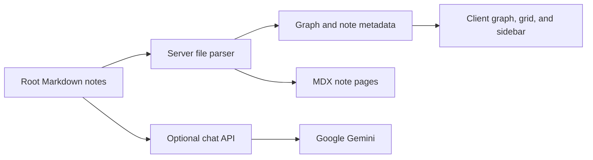

# Quant OS

**A navigable reading room for quantitative finance, risk, and applied analytics.** Quant OS turns authored Markdown notes into a 2D knowledge graph, a browsable grid, and linked long form articles. It is a learning interface for students, analysts, and reviewers following concepts across disciplines.

> **Maturity:** working source backed web prototype. The repository contains educational notes and a reading interface; it does not contain executable finance notebooks, market data, a trading engine, or a validated risk model.

## Explore the project

| Area | What the source implements |
| --- | --- |
| Knowledge graph | Root level `brain/*.md` files become nodes; valid `[[wikilinks]]` become edges. The 2D canvas supports node navigation and zoom. |
| Grid and portfolio views | Cards are grouped and sorted by note metadata. The portfolio tab filters notes in the `03 — Portfolio Projects` cluster. |
| Reading experience | Note routes render Markdown through MDX with math, tables, highlighted code, tags, metadata progress, and incoming links. |
| Search | The sidebar filters note titles locally. |
| Vian AI | Optional Gemini chat sends the root note corpus as prompt context. It needs an API key and has access and grounding limits. |

The notes span credit risk, regression, machine learning, portfolio construction, forecasting, regulation, and related projects. Reported metrics and methods in those notes are **authored accounts**, not independently reproduced by this repository. The [project blueprint](PROJECT_BLUEPRINT.md) explains the data flow, formulas, source map, and limitations.

## How it works



**Stack:** Next.js 16 App Router, React 19, TypeScript, Tailwind CSS 4, `react-force-graph-2d`, `next-mdx-remote`, KaTeX, Framer Motion, and the Vercel AI SDK. The content store is committed Markdown; there is no database or per-reader progress storage. [Parser](src/lib/markdown.ts) · [Home route](src/app/page.tsx) · [Note route](src/app/notes/%5Bslug%5D/page.tsx) · [Chat route](src/app/api/chat/route.ts)

## Run locally

With a Node.js version compatible with Next.js 16 and npm:

```bash
npm ci
npm run dev
```

Open `http://localhost:3000`. Reading and graph navigation do not need an API key. For chat, put `GOOGLE_GENERATIVE_AI_API_KEY=...` in an uncommitted `.env.local` and restart the server. Both npm and pnpm lockfiles are committed; these commands use the npm lockfile.

## Boundaries

- The graph is **2D**, and its links match filenames rather than semantic similarity.
- Progress percentages are note frontmatter values, not tracked reading activity. One root note is excluded from the graph while remaining in the grid and sidebar.
- The visible chat clearance code is checked in client code; `/api/chat` has no server authentication. The route sends the full root note corpus to Gemini and does not enforce its claimed domain restriction through retrieval, citations, or evaluation.
- No committed tests or executable modeling artifacts are present. These documents were checked against source; app runtime and financial results were not independently verified.

For setup, formulas, worked examples, troubleshooting, and the file map, read [PROJECT_BLUEPRINT.md](PROJECT_BLUEPRINT.md). [SOURCE_OF_TRUTH.md](SOURCE_OF_TRUTH.md) remains as a historical design record.
